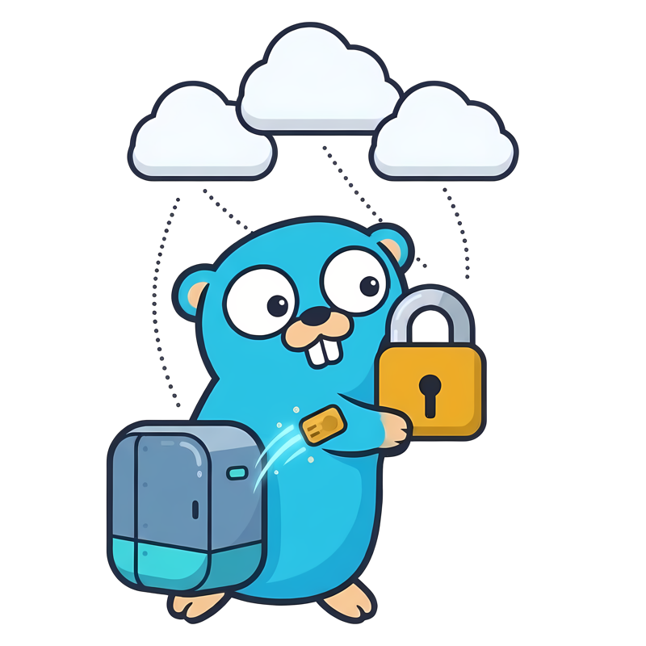

<p align="center">
  
</p>

<h1 align="center">workload-identity-sidecar</h1>

A sidecar container that trades a pod's identity for short-lived cloud credentials. No password or long-lived key is involved. The [Api](https://github.com/cujarrett/homelab/tree/main/platform/api) composition adds it to pods that need AWS, Entra or a secret.

## How it works

SPIRE gives every pod a short-lived signed token, called a JWT-SVID. It proves which pod is running. Each cloud trusts SPIRE's signing keys, so the sidecar can trade that token for real credentials.

The sidecar is one Go binary. It gets tokens from the local SPIRE agent over the Workload API socket.

The sidecar runs up to four loops. Each env var below turns one on. A pod can use any mix of them.

| Loop | Turned on by | What the app gets |
|---|---|---|
| AWS | `AWS_BINDINGS` | An AWS credentials file |
| Entra | `ENTRA_FEDERATED_TOKEN_FILE` | A token file the Azure SDK trades itself |
| Token Secret | `TOKEN_SECRET_NAME` | An Entra access token in a Kubernetes Secret |
| Secrets | `SECRET_BINDINGS` | A secret's value, one file per property |

## AWS

The sidecar writes temporary AWS credentials to a shared file.

- **Token:** it asks the local SPIRE agent for a token with the audience `sts.amazonaws.com`. Nothing leaves the cluster yet.
- **Trade:** it sends the token to AWS STS (`AssumeRoleWithWebIdentity`), once per binding.
- **Write:** it writes the credentials to `CREDS_FILE`, one named profile per binding.
- **Refresh:** every 50 minutes. The credentials last 1 hour.
- **Failure:** it keeps the old file and retries in 30 seconds. Before the first file exists, it retries every 2 seconds.

The STS call needs no signing, because the token is the proof.

## Entra

The sidecar keeps a fresh SPIRE token in a file. The app's Azure SDK trades it with Entra itself, the same way Azure Kubernetes Service works.

- **Token:** it asks SPIRE for a token with the audience `api://AzureADTokenExchange`.
- **Write:** it writes the token as-is to `ENTRA_FEDERATED_TOKEN_FILE`.
- **Refresh:** every 240 seconds. SPIRE tokens last 5 minutes.

The app's SDK reads `AZURE_CLIENT_ID`, `AZURE_TENANT_ID` and `AZURE_FEDERATED_TOKEN_FILE`. The Api composition sets all three. The sidecar never sees the access token.

## Token Secret

Some controllers read their credential only from a Kubernetes Secret, such as [Temporal's Worker Controller](https://docs.temporal.io/production-deployment/worker-deployments/kubernetes-controller). This loop keeps an Entra access token in one.

- **Token:** it asks SPIRE for a token with the audience `api://AzureADTokenExchange`.
- **Trade:** it sends the token to Entra and gets an access token for `TOKEN_SCOPE`.
- **Write:** it patches the access token into Secret `TOKEN_SECRET_NAME`, in the pod's own namespace.
- **Refresh:** every 45 minutes. Entra access tokens last 60 to 90 minutes.

The Secret must already exist. The pod's service account needs `patch` on that one Secret.

## Secrets

The sidecar fetches a secret's value and writes it as files.

- **Read:** it reads `role-arn`, `secret-id` and `region` from each binding directory.
- **Trade:** it trades its own SPIRE token for AWS credentials, one role per binding.
- **Write:** it calls `GetSecretValue` and writes each property as its own file. It writes a `ready` file last.
- **Refresh:** every 15 minutes, so a rotated value arrives without a restart.
- **Failure:** it keeps the old files and retries in 30 seconds.

A secret with no value yet has nothing to write, so the fetcher waits. It writes every property the value has. The app checks that the ones it needs are there.

## Environment variables

| Variable | Description |
|---|---|
| `AWS_BINDINGS` | Comma-separated `mountPath:profile` pairs, such as `/bindings/nosql:nosql`. Turns on the AWS loop. |
| `CREDS_FILE` | Where the AWS credentials file goes, such as `/aws-credentials/credentials`. |
| `STS_AUDIENCE` | Token audience for AWS, default `sts.amazonaws.com`. It must match a client ID on the AWS identity provider. |
| `STS_ENDPOINT` | STS endpoint, default `https://sts.us-east-1.amazonaws.com`. The mesh only allows this regional host. |
| `ENTRA_FEDERATED_TOKEN_FILE` | Where the Entra token file goes, such as `/entra-identity/token`. Turns on the Entra loop. |
| `ENTRA_AUDIENCE` | Token audience for Entra, default `api://AzureADTokenExchange`. Microsoft sets this value. |
| `ENTRA_REFRESH_INTERVAL` | Seconds between Entra token refreshes, default `240`. |
| `TOKEN_SECRET_NAME` | Secret that gets an Entra access token. Turns on the Token Secret loop. Needs `TOKEN_SCOPE`, `AZURE_CLIENT_ID` and `AZURE_TENANT_ID`. |
| `TOKEN_SECRET_KEY` | Key in that Secret, default `token`. |
| `TOKEN_SCOPE` | Entra scope for the access token, such as `api://<tenant>/platform-temporal/.default`. |
| `TOKEN_REFRESH_INTERVAL` | Seconds between access token refreshes, default `2700`. |
| `SECRET_BINDINGS` | Comma-separated `bindingDir:outputDir` pairs, such as `/bindings/managed-secret-orders:/secrets/orders`. The binding is read-only, so the value needs a second, writable path. Turns on the Secrets loop. |
| `SPIFFE_SOCKET` | SPIRE socket path, default `/var/run/secrets/spiffe.io/api.sock`. |

## Volumes expected

| Mount | Contents |
|---|---|
| `/var/run/secrets/spiffe.io/` | The SPIRE socket, `api.sock`, from the SPIFFE CSI driver. |
| Each AWS binding `mountPath` | `role-arn`, from the binding Secret. |
| Folder of `CREDS_FILE` | A writable emptyDir shared with the app. |
| Folder of `ENTRA_FEDERATED_TOKEN_FILE` | A writable emptyDir shared with the app. |
| Each `SECRET_BINDINGS` binding folder | `role-arn`, `secret-id` and `region`, from the binding Secret, read-only. |
| Each `SECRET_BINDINGS` output folder | A writable emptyDir shared with the app. Holds one file per property. |

## Credentials file format

```ini
[object-storage]
aws_access_key_id = REDACTED
aws_secret_access_key = REDACTED
aws_session_token = REDACTED

[nosql]
aws_access_key_id = REDACTED
aws_secret_access_key = REDACTED
aws_session_token = REDACTED
```

The app finds this file through `AWS_SHARED_CREDENTIALS_FILE`. It picks a profile with `AWS_PROFILE_<BINDING>`. The Api composition sets both.

## Image

```
ghcr.io/cujarrett/workload-identity-sidecar:main
```

CI builds it on every push to `main`. ARM64 only, for the Raspberry Pi 5 nodes.
